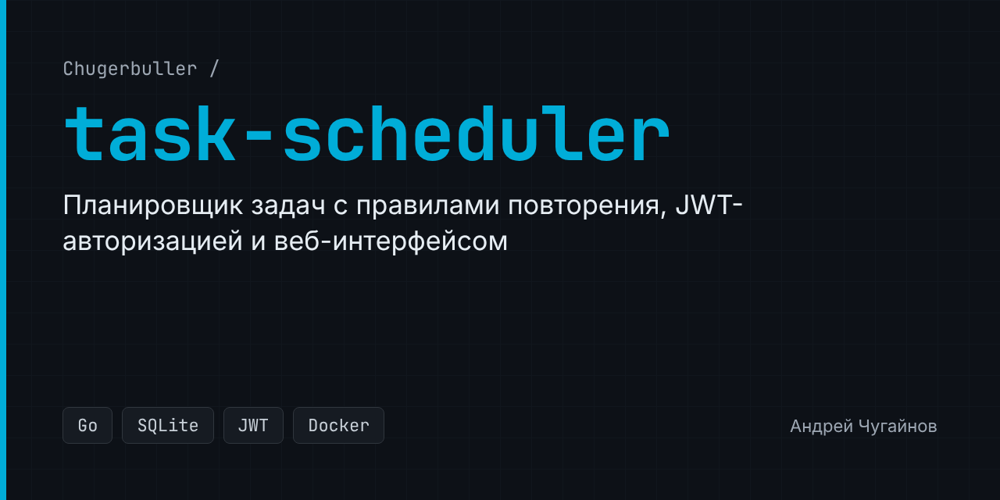

[](https://github.com/Chugerbuller/task-scheduler/actions/workflows/tests.yml)

# task-scheduler

Веб-приложение для управления задачами на Go: REST API и готовый веб-интерфейс.

## Возможности

- Создание, редактирование, удаление и поиск задач, отметка о выполнении.
- Повторяющиеся задачи: следующая дата считается по правилу (каждые N дней, ежегодно, по дням недели `w`, по дням месяца `m`).
- Авторизация по паролю с выдачей JWT.
- Настройка через переменные окружения, хранение в SQLite.
- Docker-образ и интеграционные тесты API в GitHub Actions.

## Запуск приложения

### 1. Клонирование репозитория

```bash
git clone https://github.com/Chugerbuller/task-scheduler
cd task-scheduler
```

### 2. Настройка

Скопируйте пример настроек и задайте свои значения:

```bash
cp .env.example .env
```

| Переменная | Описание | По умолчанию |
|---|---|---|
| `TODO_PORT` | порт сервера | `7540` |
| `TODO_DBFILE` | путь к файлу SQLite | `./database/scheduler.db` |
| `TODO_PASSWORD` | пароль для входа; пустой отключает авторизацию | пусто |
| `TODO_JWT_SECRET` | секрет для подписи JWT | случайный при каждом запуске |

Файл `.env` необязателен: переменные можно передать через окружение.

### 3. Запуск приложения
```bash
go mod tidy
go run ./cmd/main.go
```
### 4. Откройте браузер
```text
http://localhost:7540/login.html
```

## Тесты

Тесты обращаются к запущенному серверу, поэтому сначала запустите приложение, затем:

```bash
go test ./tests
```

Если задан `TODO_PASSWORD`, тестам нужен токен. Получите его и передайте через переменную окружения:

```bash
curl -s -X POST localhost:7540/api/signin -d '{"password":"<ваш пароль>"}'
TODO_TOKEN=<токен> go test ./tests
```

В GitHub Actions сервер запускается без пароля и прогоняются все тесты.

## Запуск через Docker

```bash
# Сборка образа
docker build -t todo-scheduler .

# Запуск контейнера с настройками из .env
docker run --env-file .env -p 7540:7540 todo-scheduler
```
